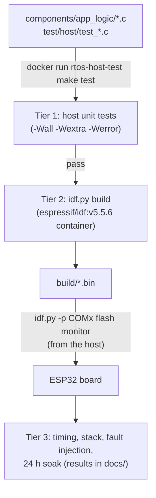

# Build & Verification Plan (Docker host tests + ESP-IDF firmware)

- **Document**: `context/code-build.md`
- **Component**: Build environment, host test harness, firmware build, quality gates
- **Target Stack**: C (ESP-IDF v5.x, FreeRTOS) on ESP32; GCC; Alpine-based test container
- **Status**: Authoritative build specification. Requirements live in [`project-overview.md`](project-overview.md). The project is **Not started**, so none of the files named here exist yet.

---

## 1. Overview & Philosophy

The firmware has a real compile step (cross-compiling for the ESP32), but most of the logic can be checked on the development machine. The build is split into tiers so the everyday loop stays fast and light.

1. **Tier 1: host build and unit tests (lightweight, every change).** A small Alpine + GCC container (~230 MB) compiles `components/app_logic/` with the tests in `test/host/` and runs them. No ESP32 and no ESP-IDF needed. Runs within `--memory 256m --cpus 1`.
2. **Tier 2: firmware build (heavy, when `main/` changes).** `idf.py build` with ESP-IDF v5.x, in the pinned official `espressif/idf:v5.5.6` container (about 9 GB on disk).
3. **Tier 3: hardware verification (on the board).** Flashing, I2C/OLED, Wi-Fi/MQTT, timing jitter, stack high-water marks, fault injection and the 24-hour soak test. Docker cannot replace this.
4. **Warnings are errors on the host.** Tier 1 compiles with `-Wall -Wextra -Werror`.
5. **Secrets stay out of the repo.** Wi-Fi credentials and broker settings live in `menuconfig`/NVS and the git-ignored `sdkconfig`. `sdkconfig.defaults` holds no credentials.



---

## 2. One-Time Setup (PowerShell, from the project root)

```powershell
# Docker Desktop installed and running
docker version

# Build the test image (again only when Dockerfile.test changes)
docker build -f Dockerfile.test -t rtos-host-test .

# Firmware toolchain: the pinned espressif/idf:v5.5.6 container (see section 5). The idf.py
# commands below run inside it (docker run --rm --memory 2g --cpus 2 ... idf.py <args>;
# add -it for menuconfig). A native ESP-IDF install is not used.
idf.py set-target esp32
idf.py menuconfig        # Wi-Fi SSID/password, MQTT URI/topic, intervals; task watchdog on; CONFIG_FREERTOS_HZ=1000
```

Files to create when implementation starts:

| File | Contents |
|---|---|
| `Dockerfile.test` | `FROM alpine:3.20`, `RUN apk add --no-cache build-base make`, `WORKDIR /work`. The source tree is bind-mounted at run time, so code changes never rebuild the image. |
| `Makefile` | Targets `test`, `docker-test`, `clean` (reference in section 4). |
| `.dockerignore` | `build/`, `build-host/`, `managed_components/`, `sdkconfig`, `.git/`, `.venv/`, `graphify-out/` |
| `.gitignore` | Already created: `build/`, `build-host/`, `managed_components/`, `sdkconfig`, `sdkconfig.old`, `.venv/`, `graphify-out/`, `__pycache__/`, `*.pyc`, `.claude/settings.local.json` |
| `sdkconfig.defaults` | Shared defaults only: FreeRTOS tick 1000 Hz, task watchdog enabled. No credentials. |

---

## 3. Daily Commands

| Action | Command |
|---|---|
| **Run all host tests** | `docker run --rm --memory 256m --cpus 1 -v "${PWD}:/work" rtos-host-test make test` |
| **Run one host test** | `docker run --rm -v "${PWD}:/work" rtos-host-test sh -c "make build-host/test_dew_point && ./build-host/test_dew_point"` |
| **Clean host build** | `docker run --rm -v "${PWD}:/work" rtos-host-test make clean` |
| **Rebuild the test image** | `docker build -f Dockerfile.test -t rtos-host-test .` |
| **Host tests via Makefile wrapper** | `make docker-test` (needs `make` on the host; it was not installed on this Windows machine when checked, so use the `docker run` line above) |
| **Build firmware** | `idf.py build` |
| **Build firmware in container** | `docker run --rm --memory 2g --cpus 2 -v "${PWD}:/project" -w /project espressif/idf:v5.5.6 idf.py set-target esp32 build` |
| **Flash and monitor** | `idf.py -p COMx flash monitor` (run on the host, not in Docker) |
| **Configure** | `idf.py menuconfig` |
| **Firmware size** | `idf.py size` |

`${PWD}` (with braces) is required in PowerShell: `"$PWD:/work"` is a parse error there. The braced form also works in POSIX shells. In Git Bash on Windows, bind-mount paths can fail to translate: use PowerShell, or set `MSYS_NO_PATHCONV=1`.

---

## 4. Host Test Harness (Tier 1)

**Scope.** Only `components/app_logic/` (pure C, no ESP-IDF or FreeRTOS includes) and `test/host/` build here. Tasks and drivers in `main/` need ESP-IDF headers and build only in Tier 2.

**Test files.** One file per module, `test/host/test_<module>.c` (for example `test_dew_point.c`), each with its own `main()` and plain `assert()` checks. A failed assertion aborts the program and fails the run.

**Do not define `NDEBUG`** for host tests. It turns `assert()` into a no-op, and failures would pass silently.

**Reference Makefile.** Run in a scratch container on 2026-11-19 against a small dew-point test: a passing test exits 0, and a failing `assert` stops `make` with a non-zero exit. Recipe lines must start with a tab.

```make
CC     ?= gcc
CFLAGS := -std=c11 -Wall -Wextra -Werror -O0 -g -Icomponents/app_logic
BUILD  := build-host
LOGIC  := $(wildcard components/app_logic/*.c)
TESTS  := $(wildcard test/host/test_*.c)
BINS   := $(patsubst test/host/%.c,$(BUILD)/%,$(TESTS))

.PHONY: test docker-test clean

test: $(BINS)
	@set -e; for t in $(BINS); do echo "== $$t"; $$t; done

$(BUILD)/%: test/host/%.c $(LOGIC) | $(BUILD)
	$(CC) $(CFLAGS) $^ -o $@ -lm

$(BUILD):
	mkdir -p $@

docker-test:
	docker build -f Dockerfile.test -t rtos-host-test .
	docker run --rm --memory 256m --cpus 1 -v "$(CURDIR):/work" rtos-host-test make test

clean:
	rm -rf $(BUILD)
```

Host binaries go to `build-host/`, so they never mix with ESP-IDF's `build/`. Required test scenarios are in [`coding-standards.md`](coding-standards.md) section 8.

---

## 5. Firmware Build (Tier 2)

- ESP-IDF **v5.x** only (CMake build, `idf.py`). Not the Arduino framework.
- Native install, or the official container. The project uses the container route, pinned to `espressif/idf:v5.5.6` (never `latest`). Always run it with `--memory 2g --cpus 2`; the Docker VM is also capped at 3 GB and 2 CPUs in `~/.wslconfig`, so a build cannot starve the laptop. The image measures 9.22 GB on disk (about 5 GB compressed) and its first build is slow.
- The container produces `build/*.bin`. Flash from the host: USB serial passthrough from Docker on Windows is unreliable.
- Set `CONFIG_FREERTOS_HZ=1000` and enable the task watchdog (`sdkconfig.defaults` or `menuconfig`).
- Run Tier 1 first. Do not build firmware while host tests fail.

---

## 6. Quality Gates

A feature is ready to commit only when every gate that applies passes:

1. **Host tests (always, if `components/app_logic/` or `test/host/` changed, and before any firmware build):** `make test` in the container exits 0, with no compiler warnings under `-Wall -Wextra -Werror`. New logic has tests for normal, boundary and failure inputs ([`coding-standards.md`](coding-standards.md) section 8).
2. **Firmware build (if `main/` or any firmware-side file changed):** `idf.py build` succeeds with no new warnings.
3. **Hardware checks (if the feature changes task, queue, timing or fault behaviour):** the matching items in the project overview's Verify and Measure steps, with results saved in `docs/`. No task stack above 75% usage.
4. **Docs in sync:** `context/project-structure.md` matches the files on disk, and `README.md` and `context/project-overview.md` agree.

Optional: `cppcheck` static analysis (add `cppcheck` to `Dockerfile.test`). Not a gate unless adopted.

Save the passing Tier 1 output in `docs/` as test evidence. The overview lists it as a deliverable.

---

## 7. Continuous Integration (optional, later)

CI is not needed for a solo learning project. If added, start with a manual `workflow_dispatch` trigger and run the same Tier 1 gate:

```yaml
- uses: actions/checkout@v4
- run: docker build -f Dockerfile.test -t rtos-host-test .
- run: docker run --rm -v "${PWD}:/work" rtos-host-test make test
```

Never put Wi-Fi credentials or broker secrets in CI. Builds there use `sdkconfig.defaults` only.

---

## 8. Docker

Used for Tier 1 (host build and tests) and, optionally, the Tier 2 firmware build. Not used for flashing, hardware tests, timing measurement or the soak test.

---

## 9. Optional Tooling: graphify Knowledge Graph (Python `.venv`)

The only Python in this project. It is dev tooling for navigating the code and is not part of the firmware build, the host tests or the quality gates. The decision (s0-t12) is to keep it as optional tooling.

- **Package**: `graphifyy` (two y's) from PyPI. The name `graphify` does not exist there. Pinned in `requirements-dev.txt` to **0.9.110**, the newest release that supports the installed Python 3.10 (0.9.111 and later need 3.11).
- **Environment**: a project-local `.venv`. Nothing is installed globally.

```powershell
python -m venv .venv
.\.venv\Scripts\python.exe -m pip install -r requirements-dev.txt
& .\.venv\Scripts\graphify.exe . --update --code-only      # builds or refreshes graphify-out/
& .\.venv\Scripts\graphify.exe query "sensor_task"         # once the graph has C code in it
```

- `--code-only` parses with tree-sitter on this machine. No LLM calls, and no files are sent to an external service. Markdown docs are skipped in this mode.
- Re-run the update command after C source changes. The Stop hook (`graphify-staleness.py`) asks for it only when a commit newer than the graph touched C or C++ source (`.c`, `.h`, `.cpp`, `.hpp`), or when `graph.json` is missing, graphify is installed in `.venv` and C source exists. It stays silent for docs, JSON, hook and config commits, for a project with no C source yet, and where graphify is not installed. The graph's age is the newest file in `graphify-out/`.
- **Do not run `graphify install`.** It copies skills into global platform config folders.
- Running graphify can also refresh an already-installed graphify skill in a global config folder (it updated one under `~/.gemini` on 2026-11-19 and kept a `SKILL.md.bak`). Set `GRAPHIFY_NO_AUTO_REFRESH=1` to prevent that.
- On 2026-11-19 the graph covered only the Python hook scripts in `.claude/` and `.agents/` (12 at that time, 10 after s0-t12), because no C code existed yet. It becomes useful for this project once `main/` and `components/` have real source. The scaffold `main/main.c` now exists, so the Stop hook applies.
