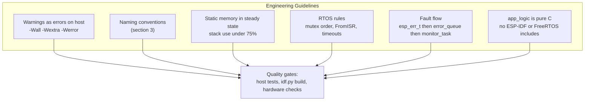
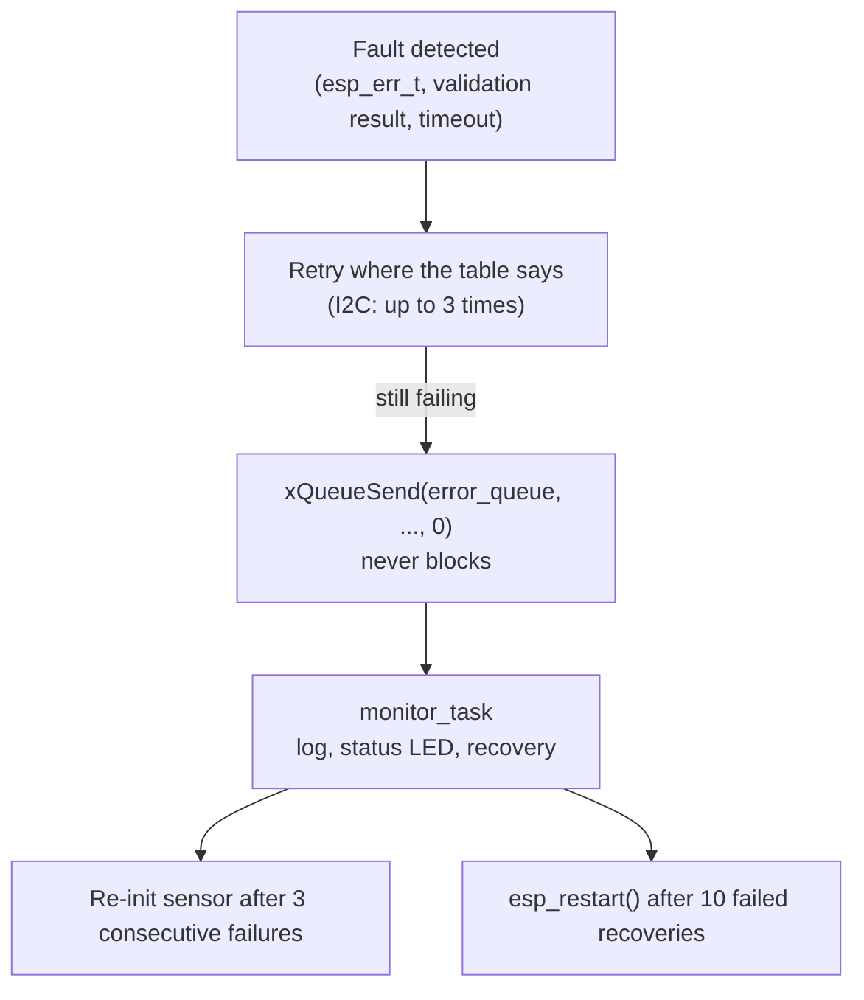

# C Coding Standards, Naming & Fault Handling (ESP-IDF / FreeRTOS)

Requirements and design decisions live in [`project-overview.md`](project-overview.md). This file defines how the C code is written to meet them. If the two disagree, the overview wins and this file is fixed.

## 1. Core Engineering Philosophy

This project is a multi-task FreeRTOS application on an ESP32. The code must be small, readable and predictable, because timing, memory and fault recovery are the point of the exercise.

1. **Predictable timing**: periodic work uses `vTaskDelayUntil`. Waits on shared objects have defined timeouts. Mutex hold times are short.
2. **Static memory in steady state**: queues, mutexes, event groups and tasks are created at startup. No `malloc`/`free` afterwards.
3. **Explicit faults**: every failure is detected, reported to `error_queue`, and recovered from per the error-handling table. Nothing hangs.
4. **Observable**: `ESP_LOG*` output with a tag per module, plus measured stack high-water marks and heap monitoring.
5. **Testable on the host**: decision logic lives in `components/app_logic/` as pure C, so it is unit-tested in the Docker test container.



---

## 2. Formatting & Style

The overview does not mandate a formatter, so match the surrounding code and ESP-IDF style.

- 4-space indent, no tabs in C sources, K&R braces, lines up to 100 columns.
- Fixed-width types (`uint8_t`, `uint32_t`, `int16_t`). `const` wherever data is read-only. `static` for file-local functions and variables.
- Headers use `#pragma once`.
- Every pin, period, priority, stack size, queue depth and timeout is defined in `main/app_config.h`. No magic numbers in task code.
- Comment the *why* (timing reasons, priority choices, lock ordering), not the *what*.

### 2.1 Include Grouping
Separated by blank lines:

```c
/* 1. C standard library */
#include <stdint.h>
#include <string.h>

/* 2. FreeRTOS / ESP-IDF */
#include "freertos/FreeRTOS.h"
#include "freertos/task.h"
#include "esp_log.h"

/* 3. Project */
#include "app_config.h"
#include "dew_point.h"
```

---

## 3. Naming Conventions

Names that the overview already defines are used exactly as written.

| Thing | Convention | Examples |
|---|---|---|
| Files | `snake_case` | `sensor_task.c`, `bme280.c`, `dew_point.c` |
| Tasks | function and task name `<role>_task` | `sensor_task`, `process_task`, `display_task`, `comms_task`, `monitor_task` |
| Types | `snake_case_t` | `sample_t`, `reading_t`, `error_event_t` |
| Shared objects | exactly as in the overview table | `raw_queue`, `publish_queue`, `error_queue`, `i2c_mutex`, `data_mutex`, `button_sem`, `sys_events` |
| Shared data | exactly as in the overview | `latest` (protected by `data_mutex`) |
| Event bits | the overview's bit names, as `<NAME>_BIT` macros | `WIFI_CONNECTED_BIT`, `MQTT_CONNECTED_BIT`, `SENSOR_OK_BIT` |
| Public functions | module prefix | `dew_point_c()`, `moving_average_push()`, `validate_sample()`, `bme280_read()` |
| Config macros | `UPPER_SNAKE` in `app_config.h`, with a unit suffix | `SAMPLE_PERIOD_MS`, `PUBLISH_PERIOD_MS`, `I2C_MUTEX_TIMEOUT_MS`, `SENSOR_TASK_PRIO`, `SENSOR_TASK_STACK_BYTES` |
| Log tags | one `static const char *TAG` per file, equal to the module name | `static const char *TAG = "sensor_task";` |
| Return codes | `esp_err_t` in firmware code, a small enum in `app_logic` | see section 4 |

Values to keep in sync with the overview: priorities `monitor_task` 6, `sensor_task` 5, `process_task` 4, `display_task` 3, `comms_task` 3; queue depths `raw_queue` 8, `publish_queue` 10, `error_queue` 8.

---

## 4. Fault Handling

`app_logic` cannot use `esp_err_t` (it must not include ESP-IDF headers). It returns its own plain C result enum instead, and the calling task turns that result into an `error_event_t` when needed.



| Fault | Detection | Response (from the overview) |
|---|---|---|
| I2C read failure or timeout | `esp_err_t` return | Retry up to 3 times, then report to `error_queue`, clear `SENSOR_OK`, re-initialise the sensor. |
| Out-of-range value | Temperature −40 to 85 °C, humidity 0–100 %, or a jump of more than 10 °C between samples | Discard the sample and count it as a fault. |
| Wi-Fi/MQTT loss | Event handler | Keep sampling and displaying, buffer readings, reconnect with backoff (1 s doubling to 60 s). |
| Queue full | `xQueueSend` timeout | Drop the oldest, count the drop, log it. |
| Task hang | Task watchdog (10 s) | Log the cause and restart. |
| Low heap | Heap monitor below the threshold (for example 20 KB) | Log a warning, restart if it continues to fall. |

Rules:

- **`ESP_ERROR_CHECK` is for startup and initialisation only.** It aborts on failure, so it must not appear in steady-state paths, which have to recover (FR-8).
- Check the result of every ESP-IDF and FreeRTOS call whose failure can happen (`xQueueSend`, `xSemaphoreTake`, I2C and network calls).
- Senders to `error_queue` use a zero timeout.
- A mutex timeout is an error, reported to `error_queue`, never ignored.
- The system must keep sampling and displaying when Wi-Fi or the broker is down.

---

## 5. Forbidden Patterns

1. **Dynamic allocation in steady state**: `malloc`, `calloc`, `realloc`, `free`, or any API that allocates, in task loops after startup.
2. **Blocking or heavy work in an ISR**: no mutex, no queue wait, no logging. Use `FromISR` APIs only, and only inside the ISR (never in tasks).
3. **Holding two mutexes at once**. If unavoidable, take `i2c_mutex` before `data_mutex`, always.
4. **Unbounded waits on shared hardware**: `i2c_mutex` is taken with a 100 ms timeout. A task monitored by the task watchdog must not block longer than the 10 s watchdog timeout.
5. **Busy-wait loops or `vTaskDelay` for timed sampling**: periodic tasks use `vTaskDelayUntil`.
6. **Shared mutable state outside the defined objects**: tasks communicate through the queues, mutexes, semaphore and event group in the overview, and `latest` is touched only under `data_mutex`.
7. **FreeRTOS or ESP-IDF includes in `components/app_logic/`**.
8. **Large stack arrays or recursion** in tasks. Stacks are sized in the overview (3–6 KB) and must stay under 75% used.
9. **Hard-coded credentials, broker URLs or device IDs.**

---

## 6. RTOS Invariants

1. **Created at startup**: all queues, mutexes, the semaphore, the event group and the tasks are created in `main.c` before they are used.
2. **Priorities** follow the overview table: `monitor_task` 6 (highest), `sensor_task` 5, `process_task` 4, `display_task` 3, `comms_task` 3.
3. **Bus access**: `i2c_mutex` is held only around the I2C transaction (a few milliseconds at most). Priority inheritance (a FreeRTOS mutex, not a binary semaphore) is used.
4. **Display**: `display_task` copies `latest` under `data_mutex`, releases it, then takes `i2c_mutex` to draw. The two are never held together.
5. **Button**: the ISR calls `xSemaphoreGiveFromISR(button_sem)` and handles the higher-priority-task-woken flag. Debounce is applied, and the display reacts within 200 ms.
6. **Sampling**: every 5 s with `vTaskDelayUntil`, jitter under ±50 ms.
7. **Queues**: `error_queue` senders never block. When `publish_queue` is full, the oldest entry is dropped and counted.
8. **Faults never stop the loop**: a failed sample or a lost connection is reported and the task keeps running.
9. **Stack headroom**: each task keeps at least 25% free, measured with `uxTaskGetStackHighWaterMark`.

---

## 7. Logging & Secrets

```c
static const char *TAG = "sensor_task";
ESP_LOGW(TAG, "I2C read failed (%s), retry %d/3", esp_err_to_name(err), attempt);
```

- `ESP_LOGE`: unrecoverable or repeated failures. `ESP_LOGW`: recovered faults, retries, dropped readings. `ESP_LOGI`: start-up steps, each processed sample, connection state changes. `ESP_LOGD`/`ESP_LOGV`: development detail.
- Do not log from ISRs or while holding a mutex longer than needed.
- During an outage, log the first failure and count the repeats, so the serial port is not flooded.
- **Secrets**: Wi-Fi credentials, broker URL/credentials and device ID come from `menuconfig`/NVS (FR-10). They are never in source, logs, `sdkconfig.defaults`, tests or commits. `sdkconfig` is git-ignored.

---

## 8. Testing Standards

### 8.1 Host unit tests (Docker test container)

- Location: `test/host/test_<module>.c`, one per `app_logic` module, plain `assert()`, each with its own `main()`. Never define `NDEBUG`.
- Compiled with `-Wall -Wextra -Werror` and linked with `-lm`. See [`code-build.md`](code-build.md) section 4.
- Required scenarios:
  1. **Moving average**: first sample, partial window (fewer than 5 samples; decide and document the behaviour), full window, window rolling over, constant input, step input.
  2. **Validation**: temperature at the limits −40 and 85 °C (accepted) and just outside (rejected); humidity at 0 and 100 % (accepted) and just outside (rejected); a jump of exactly 10 °C (accepted) and more than 10 °C (rejected); first sample with no previous value; NaN input.
  3. **Dew point**: known value (20 °C, 50 % RH gives about 9.27 °C, within 0.1); 100 % RH returns the air temperature; a low-humidity edge case. **0 % RH is valid input**, and the Magnus formula takes `log(0)`, so the function must return a defined value or an error, never NaN or infinity.
  4. **Failure paths**: every rejection branch is hit at least once.

### 8.2 Hardware verification (real ESP32, results in `docs/`)

Host tests prove the logic, not the RTOS behaviour. These are checked on the board, per the overview:

- Timing: sampling jitter under ±50 ms, sample-to-display latency under 1.5 s, display refresh 1 s, button response within 200 ms, MQTT publish every 30 s (±1 s), reconnect backoff 1 s to 60 s.
- Stack high-water mark per task, all under 75% used.
- Fault injection: sensor unplugged, Wi-Fi off, broker down, queue overflow. Each must recover without manual intervention.
- 24-hour soak: no reset, no heap growth.

---

## 9. Cross-Document References

- **Requirements, architecture, timing, error handling**: [`project-overview.md`](project-overview.md)
- **Build, test harness & quality gates**: [`code-build.md`](code-build.md)
- **Layout & module boundaries**: [`project-structure.md`](project-structure.md)
- **Working agreement**: [`ai-interaction.md`](ai-interaction.md)
