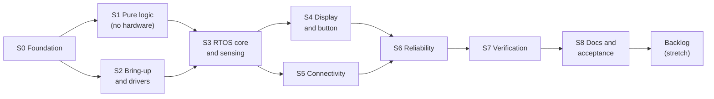

# Implementation Roadmap: RTOS Weather Station

Sprint-by-sprint plan from an empty firmware tree to the acceptance criteria in [`../project-overview.md`](../project-overview.md). Every requirement in the overview has a reference ID (section 2) and is traced to at least one task (section 11, generated from the task tables).

## 1. How to Use This Roadmap

- **A sprint is a milestone, not a calendar slot.** The project is a solo learning project with no fixed team velocity, so no dates or hour estimates are given. Size tags are relative: **S** = one focused sitting, **M** = a few sittings, **L** = most of a sprint.
- **Tasks are atomic.** Each has one deliverable and a "Done when" check that can be observed. Task IDs follow `s<sprint>-t<n>-<task-name>` (for example `s1-t3-moving-average-test`). Backlog tasks use sprint number 9.
- **Verification tiers** are the ones in [`../code-build.md`](../code-build.md): **T1** host unit tests in the Docker container, **T2** `idf.py build`, **T3** checks on the real ESP32. A task marked **[HW]** needs the board and parts.
- **Dependencies** are listed in the "After" column. Tasks with no unmet dependency can run in parallel (Sprint 1 needs no hardware and can run while parts are on order).
- **Per-sprint spec files** `spec-00-foundation.md` to `spec-08-docs-acceptance.md` sit beside this file, one per sprint, numbered to match. This roadmap stays the master: if a spec and the roadmap disagree, the roadmap wins, so edit both together.
- **Load one sprint at a time** into `context/current-feature.md` and follow the workflow in [`../ai-interaction.md`](../ai-interaction.md): branch, implement, verify, ask before committing, merge, update tracker.
- **Open decisions** (section 4) are places where the overview is silent or ambiguous. Each is assigned to the sprint that must settle it, with a recommended default. Record the outcome in the Decision log (section 10).
- **Where this plan adds to the overview**, it says so (extra `app_logic` modules, `Kconfig.projbuild`, fault-injection hooks). Update the overview, README and `project-structure.md` together when that happens.

### Sprint-close checklist (applies to every sprint)

1. Quality gates in `code-build.md` section 6 pass for what the sprint touched.
2. `context/project-structure.md` matches the files on disk.
3. `README.md` and `context/project-overview.md` are in sync.
4. `context/current-feature.md` is updated and the finished work is added to history.
5. Lessons learned go in the README "Notes" section.
6. Commit with a Conventional Commit message (ask first, stage explicit paths), merge into `main`, delete the branch.

### Starting state (already done)

Specification and context docs, GitHub repo, `.gitignore`, `requirements-dev.txt` and the optional graphify tooling exist. No firmware, Dockerfile, Makefile or source code exists yet.

---

## 2. Reference IDs

The overview does not number most of its requirements. These IDs are assigned here and are used in the "Covers" column of every task.

### 2.1 Goals, functional and non-functional requirements

| ID | Requirement | Source |
|----|-------------|--------|
| GOAL-1 | Multi-task FreeRTOS application with clean task boundaries | Goals 1 |
| GOAL-2 | Queues, mutexes, binary semaphores and event groups, each for the problem it suits | Goals 2 |
| GOAL-3 | Meet defined timing with `vTaskDelayUntil` and measure it | Goals 3 |
| GOAL-4 | Handle sensor, network and resource faults without hanging | Goals 4 |
| FR-1 | Sample temperature and humidity every 5 s | Functional |
| FR-2 | Validate samples (range, rate of change) and smooth with a 5-sample moving average | Functional |
| FR-3 | Calculate dew point from the filtered values | Functional |
| FR-4 | Show temperature, humidity, dew point and Wi-Fi/MQTT status on the 128x64 OLED, refreshed every 1 s | Functional |
| FR-5 | Push button toggles C/F, via ISR and semaphore | Functional |
| FR-6 | Publish JSON readings to MQTT every 30 s with SNTP timestamp and device ID | Functional |
| FR-7 | Keep sampling and displaying when Wi-Fi or broker is down; reconnect with exponential backoff 1 s to 60 s | Functional |
| FR-8 | Detect sensor failures (I2C error or out-of-range), report them, recover by re-initialising | Functional |
| FR-9 | Task watchdog and heap monitor; status LED shows system state | Functional |
| FR-10 | Configuration (Wi-Fi credentials, broker URL, intervals) in `menuconfig`/NVS, not in code | Functional |
| NFR-1 | No dynamic allocation in steady state | Non-functional |
| NFR-2 | Every task has a measured stack high-water mark with at least 25% headroom | Non-functional |
| NFR-3 | 24-hour continuous run without reset or heap growth | Non-functional |
| NFR-4 | Signal-processing logic is pure C (no ESP-IDF or FreeRTOS includes), tested on the host | Non-functional |

### 2.2 Platform, hardware, tasks, objects, rules

| ID | Requirement | Source |
|----|-------------|--------|
| PLT-1 | ESP32-DevKitC, ESP-IDF v5.x, native FreeRTOS (not the Arduino framework) | Platform decision |
| HW-1 | ESP32-DevKitC (WROOM-32E, 4 MB flash), USB 5 V power | Hardware |
| HW-2 | BME280 on I2C, address 0x76 or 0x77 | Hardware |
| HW-3 | SSD1306 128x64 OLED on I2C, address 0x3C, sharing the bus with the sensor | Hardware |
| HW-4 | Push button on GPIO4, internal pull-up, falling-edge interrupt | Hardware |
| HW-5 | Status LED on GPIO2 (or onboard) with 330 ohm resistor | Hardware |
| HW-6 | Wiring: SDA GPIO21, SCL GPIO22, 3.3 V/GND, 4.7 k pull-ups if the breakouts lack them, breadboard | Hardware / Wiring |
| HW-7 | Alternate sensors (SHT31) can replace the BME280 | Hardware alternates |
| TSK-1 | `monitor_task`: priority 6, 3 KB, blocks on `error_queue` plus 10 s housekeeping | Task breakdown |
| TSK-2 | `sensor_task`: priority 5, 4 KB, every 5 s with `vTaskDelayUntil` | Task breakdown |
| TSK-3 | `process_task`: priority 4, 3 KB, blocks on `raw_queue` | Task breakdown |
| TSK-4 | `display_task`: priority 3, 3 KB, takes `button_sem` with 1 s timeout | Task breakdown |
| TSK-5 | `comms_task`: priority 3, 6 KB, waits on `WIFI_CONNECTED_BIT` | Task breakdown |
| ISR-1 | Button ISR is not a task; it calls `xSemaphoreGiveFromISR(button_sem)` | Task breakdown |
| OBJ-1 | `raw_queue`: 8 x `sample_t`, `sensor_task` to `process_task` | Inter-task communication |
| OBJ-2 | `publish_queue`: 10 x `reading_t`, `process_task` to `comms_task`, drop oldest when full | Inter-task communication |
| OBJ-3 | `error_queue`: 8 x `error_event_t`, all tasks to `monitor_task`, senders never block | Inter-task communication |
| OBJ-4 | `i2c_mutex` with priority inheritance, shared by `sensor_task` and `display_task` | Inter-task communication |
| OBJ-5 | `data_mutex` protecting the shared `latest` struct | Inter-task communication |
| OBJ-6 | `button_sem` binary semaphore, ISR to `display_task`, debounced | Inter-task communication |
| OBJ-7 | `sys_events` event group, 3 bits: `WIFI_CONNECTED`, `MQTT_CONNECTED`, `SENSOR_OK` | Inter-task communication |
| RUL-1 | Keep mutex hold times short (microseconds to a few milliseconds) | Rules |
| RUL-2 | Never hold two mutexes at once; if unavoidable take `i2c_mutex` before `data_mutex` | Rules |
| RUL-3 | Use `FromISR` APIs only inside the ISR | Rules |

### 2.3 Timing and error handling

| ID | Requirement | Source |
|----|-------------|--------|
| TIM-1 | Sampling period 5 s, jitter under +/-50 ms | Timing |
| TIM-2 | Sample-to-display latency under 1.5 s | Timing |
| TIM-3 | Display refresh 1 s | Timing |
| TIM-4 | Button response within 200 ms | Timing |
| TIM-5 | MQTT publish every 30 s, tolerance +/-1 s when connected | Timing |
| TIM-6 | I2C mutex wait timeout 100 ms; a timeout is reported as an error | Timing |
| TIM-7 | Wi-Fi reconnect backoff 1 s doubling up to 60 s | Timing |
| TIM-8 | Sensor re-init after 3 consecutive failures; restart after 10 failed recoveries | Timing |
| TIM-9 | Task watchdog 10 s on `sensor_task`, `process_task` and `monitor_task` | Timing |
| TIM-10 | FreeRTOS tick 1000 Hz | Timing |
| ERR-1 | I2C read failure or timeout: retry up to 3 times, report, clear `SENSOR_OK`, re-init sensor | Error handling |
| ERR-2 | Out-of-range value (temp -40 to 85, humidity 0 to 100, jump over 10 C): discard and count as a fault | Error handling |
| ERR-3 | Wi-Fi/MQTT loss: keep sampling and displaying, buffer, reconnect with backoff | Error handling |
| ERR-4 | Queue full: drop oldest, count the drop, log it | Error handling |
| ERR-5 | Task hang: task watchdog logs the cause and restarts | Error handling |
| ERR-6 | Low heap (for example below 20 KB): log a warning, restart if it keeps falling | Error handling |

### 2.4 Build, deliverables, acceptance, stretch

| ID | Requirement | Source |
|----|-------------|--------|
| BLD-1 | Lightweight host test image (Alpine + GCC, about 230 MB) running within 256 MB and 1 CPU | Docker workflow |
| BLD-2 | `make test` / `make docker-test` with `-Wall -Wextra -Werror`, non-zero exit on failure | Docker workflow |
| BLD-3 | Firmware build with ESP-IDF v5.x, natively or in the `espressif/idf` container | Docker workflow / Setup |
| BLD-4 | Flash and monitor from the host, not from Docker | Docker workflow / Setup |
| DEL-1 | Source code in the specified layout, commented, no hard-coded credentials | Deliverables |
| DEL-2 | `docs/`: wiring diagram, task and communication diagram, priorities/stacks/measured high-water marks table | Deliverables |
| DEL-3a | Test evidence: unit tests for moving average, validation and dew point | Deliverables |
| DEL-3b | Test evidence: fault-injection results (sensor unplugged, Wi-Fi off, broker down, queue overflow) | Deliverables |
| DEL-3c | Test evidence: 24-hour soak log with stable heap and no resets | Deliverables |
| DEL-3d | Test evidence: timing measurements against the requirements table | Deliverables |
| DEL-4 | Demo: video or screenshots of OLED, serial log and MQTT subscriber output | Deliverables |
| DEL-5 | Reflection notes in README: priority inversion, stack sizing, what to change for STM32 | Deliverables |
| ACC-1 | All functional requirements FR-1 to FR-10 pass | Acceptance |
| ACC-2 | All timing requirements are met in measurement | Acceptance |
| ACC-3 | Recovers from every fault in the error-handling table without manual intervention | Acceptance |
| ACC-4 | No task stack above 75% usage | Acceptance |
| ACC-5 | `make docker-test` passes in the lightweight container with no warnings | Acceptance |
| STR-1 | Stretch: DHT22 on the RMT peripheral, compared with the BME280 | Stretch |
| STR-2 | Stretch: deep or light sleep between samples, with current measurement (optional 18650 power) | Stretch |
| STR-3 | Stretch: BLE or HTTP/web dashboard serving readings | Stretch |
| STR-4 | Stretch: port to STM32 with an external Wi-Fi module | Stretch |

---

## 3. Sprint Overview and Dependencies

| Sprint | Goal | Needs hardware | Exit gate |
|--------|------|:--------------:|-----------|
| 0 | Foundation: Docker test loop, ESP-IDF scaffold, config files | Light | Host harness proven; scaffold flashes and boots |
| 1 | Pure-C logic with host unit tests | No | `make docker-test` green; all `app_logic` modules tested |
| 2 | Hardware bring-up and drivers | Yes | I2C scan shows 0x76 and 0x3C; sensor, OLED, LED, button each work alone |
| 3 | RTOS core and sensing pipeline | Yes | Serial log shows a processed sample every 5 s through all queues |
| 4 | Display and button | Yes | OLED updates each second; button toggles C/F within 200 ms |
| 5 | Connectivity: Wi-Fi, SNTP, MQTT, config | Yes | JSON readings arrive every 30 s; sampling survives network loss |
| 6 | Reliability: monitor, recovery, watchdog, heap, LED, fault injection | Yes | Every fault in the error table recovers on the bench |
| 7 | Verification and measurement | Yes | Timing, stack, fault-injection and 24 h soak evidence collected |
| 8 | Documentation, demo, acceptance | No | ACC-1 to ACC-5 checked with evidence; status set to complete |
| Backlog | Stretch goals | Varies | Not scheduled |

Critical path: S0, S2, S3, S5, S6, S7, S8. Sprint 1 is off the critical path and fills the wait for parts. The 24-hour soak (s7-t13-soak-24h) is the longest single wait and needs a stable power supply and a machine that can capture serial for a full day.

---

## 4. Open Decisions

The overview does not settle these. Decide in the sprint shown, and log the outcome in section 10.

| ID | Decision | Sprint | Recommended default | Why it matters |
|----|----------|--------|---------------------|----------------|
| D-1 | Moving-average output before 5 samples exist | 1 | Average of the samples received so far | "5-sample moving average" does not say what the first four outputs are |
| D-2 | Dew point at 0 %RH | 1 | Clamp humidity to a small minimum (for example 1 %) inside `dew_point`, and document it | 0 %RH is valid per FR-2, but the Magnus formula takes `log(0)` and returns NaN (checked in a container run) |
| D-3 | Where shared types live | 1 | `main/app_types.h`, stdint-only; `app_logic` functions take plain values | Keeps `app_logic` free of project types and still host-testable |
| D-4 | I2C driver API | 2 | The ESP-IDF v5.x `i2c_master` driver, if the installed version documents it as current; confirm against its docs | The legacy driver is deprecated in v5.x |
| D-5 | OLED layout and font | 2 | Four text lines (temperature, humidity, dew point, status) plus unit marker, small fixed font | FR-4 lists the fields but not the layout |
| D-6 | Status LED patterns | 6 | Solid = OK, slow blink = no network, fast blink = sensor fault, double blink = critical | FR-9 says "shows system state" without defining states |
| D-7 | Event-group bit naming | 3 | Bits named as in the overview, macros `<NAME>_BIT` | The overview uses both `WIFI_CONNECTED` and `WIFI_CONNECTED_BIT` |
| D-8 | Task core affinity | 3 | Unpinned (`xTaskCreate`) unless measurement shows a need; document why | The ESP32 is dual-core and the overview mentions pinning only as an available feature |
| D-9 | Watchdog interaction with blocking waits | 3 | `process_task` and `monitor_task` wait with a timeout well under 10 s (for example 2 s) and each subscribed task feeds its own watchdog entry | `process_task` blocks on `raw_queue` and `monitor_task` has a 10 s housekeeping period, which would equal the 10 s watchdog timeout and cause false resets when the sensor fails |
| D-10 | Button debounce method | 4 | Ignore edges within a window set from the bounce measured in s2-t14-button-bounce-measure, applied in the ISR | Must give one press = one semaphore give and stay inside the 200 ms response budget |
| D-11 | JSON schema, timestamp format and pre-sync behaviour | 1 | `device_id`, ISO 8601 UTC `ts`, `temperature_c`, `humidity_pct`, `dew_point_c`; before SNTP sync send an explicit marker, not a fake time | FR-6 names the fields loosely; the SNTP delay at boot is not specified |
| D-12 | How `monitor_task` asks `sensor_task` to re-init | 6 | Task notification to `sensor_task`, which does the re-init itself under `i2c_mutex` | The overview says monitor "restarts the sensor" but the sensor owns the bus access |
| D-13 | Scope of NFR-1 "no dynamic allocation" | 3 | Application code only: static buffers for JSON, framebuffer and averages; ESP-IDF internals (Wi-Fi, MQTT) are excluded and covered by the heap-growth check | The Wi-Fi and MQTT stacks allocate internally |
| D-14 | "Restart if heap continues to fall" criterion | 1 | Below 20 KB threshold, restart if the minimum free heap fell on N consecutive housekeeping checks (choose N and log it) | ERR-6 does not define "continues" |
| D-15 | MQTT topic, QoS and retain | 5 | Topic `weather/<device_id>/reading`, QoS 1, no retain | The overview's subscriber example uses `weather/#` only |
| D-16 | Behaviour on reconnect with buffered readings | 5 | Send oldest first, one per publish tick or rate-limited, never in an unbounded burst | Keeps the 30 s cadence meaningful and protects `comms_task` stack |
| D-17 | Soak pass criterion for "no heap growth" | 7 | Minimum free heap at hour 24 is no lower than at hour 1 minus a stated margin (for example 1 KB), and no reset | NFR-3 does not quantify growth |

---

## 5. Sprint 0: Foundation and Toolchain

**Goal:** a reproducible host test loop and a firmware scaffold that boots on the board, before any feature work. **Branch:** `chore/foundation`. **Status:** Not started.

| ID | Task | Covers | After | Size | Done when |
|----|------|--------|-------|:----:|-----------|
| s0-t1-parts-and-hardware-check | Parts check: ESP32-DevKitC (WROOM-32E, 4 MB), BME280 breakout (note its address strap and whether it has pull-ups), SSD1306 128x64 I2C OLED, push button, LED + 330 ohm resistor, breadboard, jumpers, 4.7 k resistors, USB data cable, logic analyser (needed for S7 jitter measurement). Order anything missing now. | HW-1, HW-2, HW-3, HW-4, HW-5, HW-6 | - | S | Every part is in hand or on order, and pull-up presence is noted |
| s0-t2-test-image | Install Docker. Create `Dockerfile.test` (`alpine:3.20`, `build-base`, `make`, `WORKDIR /work`) and `.dockerignore`. | BLD-1 | - | S | `docker build -f Dockerfile.test -t rtos-host-test .` succeeds; image is about 230 MB |
| s0-t3-makefile | Create `Makefile` with `test`, `docker-test`, `clean` from the reference in `code-build.md` section 4 (recipe lines use tabs; host binaries go to `build-host/`). | BLD-2 | s0-t2-test-image | S | `make` parses; targets match the reference |
| s0-t4-harness-smoke-test | Add a temporary `test/host/test_smoke.c`. Prove a passing test exits 0 and a deliberately failing `assert` stops `make` with a non-zero exit, under `--memory 256m --cpus 1`. | BLD-1, BLD-2 | s0-t3-makefile | S | Both outcomes observed; resource caps respected |
| s0-t5-install-esp-idf | Install ESP-IDF v5.x natively (or commit to the container route) and record the exact version. | PLT-1, BLD-3 | - | M | `idf.py --version` prints a v5.x version |
| s0-t6-scaffold-project | Scaffold the ESP-IDF project: root `CMakeLists.txt`, `main/CMakeLists.txt`, `main/main.c` (boot banner only). Run `idf.py set-target esp32` then `idf.py build`. | PLT-1, BLD-3 | s0-t5-install-esp-idf | S | Clean build with no warnings |
| s0-t7-container-firmware-build | Optional: pull the pinned `espressif/idf` image and build the scaffold in it. Record image size and first-build time, and replace the "not pulled or measured" notes in the docs with the numbers. | BLD-3 | s0-t6-scaffold-project | S | Container build produces `build/*.bin`; numbers recorded |
| s0-t8-sdkconfig-defaults | Create `sdkconfig.defaults`: FreeRTOS tick 1000 Hz, task watchdog enabled with a 10 s timeout and restart on timeout. No credentials. | TIM-10, TIM-9, FR-9 | s0-t6-scaffold-project | S | After `fullclean` and a rebuild, the generated `sdkconfig` shows those values |
| s0-t9-app-config-header | Create `main/app_config.h`: pins (GPIO21, 22, 4, 2), I2C addresses, sample/display/publish periods, task priorities and stack sizes in bytes, queue depths, mutex timeout, backoff limits, watchdog and heap thresholds. | HW-4, HW-5, HW-6, TSK-1, TSK-2, TSK-3, TSK-4, TSK-5, OBJ-1, OBJ-2, OBJ-3, TIM-6 | s0-t6-scaffold-project | S | Values match the overview tables; no magic numbers planned outside this file |
| s0-t10-kconfig-menu | Create `main/Kconfig.projbuild` with a "Weather Station" menu: sample period, publish period, device ID, BME280 address. Wi-Fi and MQTT options are added in s5-t1-kconfig-network-options. This file is not in the overview's layout, so update the overview, README and structure doc. | FR-10, FR-1, FR-6 | s0-t6-scaffold-project | S | The options appear in `idf.py menuconfig` and reach the build as `CONFIG_*` |
| s0-t11-flash-scaffold | [HW] Flash the scaffold and open the monitor from the host. Note the COM port. | BLD-4, HW-1 | s0-t1-parts-and-hardware-check, s0-t6-scaffold-project | S | Boot banner appears on the serial monitor |
| s0-t12-adapt-agent-tooling | Adapt or remove the inherited Python-template tooling (`.claude/` and `.agents/` rules, hooks, `/feature` actions, graphify Stop hook, which now ignores docs-only commits) so the workflow gates match `code-build.md`. Decide whether to keep graphify. Remove the precedence note in `ai-interaction.md` when done. | - | - | M | Hooks and rules no longer contradict the C workflow; the Stop hook no longer fires spuriously |
| s0-t13-load-sprint-1 | Load Sprint 1 into `context/current-feature.md` and create branch `feature/app-logic`. | - | s0-t4-harness-smoke-test | S | Tracker shows the Sprint 1 goals; branch exists |

**Exit gate:** the Docker harness works both ways (pass and fail), the scaffold builds without warnings and boots on the board, and `app_config.h`, `sdkconfig.defaults` and `Kconfig.projbuild` exist.

---

## 6. Sprint 1: Pure-C Logic (host only)

**Goal:** every decision that can be made without hardware is written and unit-tested in the container. **Branch:** `feature/app-logic`. **Status:** Not started. No hardware needed.

| ID | Task | Covers | After | Size | Done when |
|----|------|--------|-------|:----:|-----------|
| s1-t1-decide-average-and-dewpoint | Settle D-1 (partial moving-average window) and D-2 (dew point at 0 %RH). Log both in section 10. | FR-2, FR-3 | s0-t4-harness-smoke-test | S | Both decisions written down with the chosen behaviour |
| s1-t2-moving-average | `components/app_logic/moving_average.[ch]`: window of 5 in a fixed struct (no heap), init/push/value API, behaviour per D-1. | FR-2, NFR-1, NFR-4 | s1-t1-decide-average-and-dewpoint | S | Compiles with `-Wall -Wextra -Werror`; no ESP-IDF includes |
| s1-t3-moving-average-test | `test/host/test_moving_average.c`: first sample, partial window, full window, rollover, constant input, step input. | FR-2, BLD-2 | s1-t2-moving-average | S | All assertions pass in the container |
| s1-t4-validate | `components/app_logic/validate.[ch]`: result enum and a validate function. Reject temperature outside -40 to 85, humidity outside 0 to 100, a jump over 10 C from the previous accepted sample, and NaN. Accept the first sample and the exact limits. | FR-2, ERR-2, NFR-4 | s1-t1-decide-average-and-dewpoint | M | Every rejection reason has a distinct result code |
| s1-t5-validate-test | `test/host/test_validate.c`: limits accepted (-40, 85, 0, 100), just outside rejected, a jump of exactly 10 accepted and more than 10 rejected, first sample, NaN. | ERR-2, BLD-2 | s1-t4-validate | S | Every rejection branch is hit at least once |
| s1-t6-dew-point | `components/app_logic/dew_point.[ch]`: Magnus formula in `float`, behaviour at 0 %RH per D-2. | FR-3, NFR-4 | s1-t1-decide-average-and-dewpoint | S | Never returns NaN or infinity for valid input |
| s1-t7-dew-point-test | `test/host/test_dew_point.c`: 20 C and 50 %RH gives about 9.27 C (within 0.1); 100 %RH returns the air temperature; 0 %RH is defined; a negative-temperature case. | FR-3, BLD-2 | s1-t6-dew-point | S | Assertions pass |
| s1-t8-unit-convert | `components/app_logic/unit_convert.[ch]` with Celsius to Fahrenheit, and `test_unit_convert.c` (freezing, boiling, negative values). | FR-5, BLD-2 | s0-t4-harness-smoke-test | S | Assertions pass |
| s1-t9-backoff | `components/app_logic/backoff.[ch]`: next delay starts at 1000 ms, doubles, caps at 60000 ms, resets on success. | TIM-7, FR-7, NFR-4 | s0-t4-harness-smoke-test | S | Compiles clean |
| s1-t10-backoff-test | `test/host/test_backoff.c`: sequence 1, 2, 4, 8, 16, 32, 60, 60 seconds; reset; no overflow after many failures. | TIM-7, BLD-2 | s1-t9-backoff | S | Assertions pass |
| s1-t11-fault-policy | `components/app_logic/fault_policy.[ch]`: count consecutive sensor failures (re-init request at 3), count failed recoveries (restart request at 10), reset counters on success. | FR-8, TIM-8, ERR-1, NFR-4 | s0-t4-harness-smoke-test | M | State machine is a plain struct with no timers or RTOS calls |
| s1-t12-fault-policy-test | `test/host/test_fault_policy.c`: 2 failures do nothing, 3 request re-init, success resets, 10 failed recoveries request restart. | TIM-8, BLD-2 | s1-t11-fault-policy | S | Assertions pass |
| s1-t13-heap-policy | Settle D-14. `components/app_logic/heap_policy.[ch]`: decide ok / warn / restart from free-heap samples against the 20 KB threshold and the falling-trend rule. | ERR-6, FR-9, NFR-3, NFR-4 | s0-t4-harness-smoke-test | M | Decision is a pure function of the supplied samples |
| s1-t14-heap-policy-test | `test/host/test_heap_policy.c`: above threshold, below threshold, falling then recovering, falling for N checks. | ERR-6, BLD-2 | s1-t13-heap-policy | S | Assertions pass |
| s1-t15-reading-json | Settle D-11. `components/app_logic/reading_json.[ch]`: format a reading into a caller-supplied buffer with length checking (no heap). | FR-6, NFR-1, NFR-4 | s1-t1-decide-average-and-dewpoint | M | Returns an error instead of overflowing a too-small buffer |
| s1-t16-reading-json-test | `test/host/test_reading_json.c`: exact output for a known reading, truncation detection, pre-sync timestamp marker. | FR-6, BLD-2 | s1-t15-reading-json | S | Assertions pass |
| s1-t17-app-types-header | Settle D-3. `main/app_types.h` (stdint-only): `sample_t`, `reading_t`, `error_event_t`, and fault source/code enums. | OBJ-1, OBJ-2, OBJ-3, FR-8 | s1-t4-validate | S | Compiles in the firmware build and on the host |
| s1-t18-full-suite-run | Delete `test_smoke.c`. Run the whole suite from clean. Save the passing output to `docs/test-results/host-tests.txt`. | BLD-2, DEL-3a, ACC-5 | s1-t3-moving-average-test, s1-t5-validate-test, s1-t7-dew-point-test, s1-t10-backoff-test, s1-t12-fault-policy-test, s1-t14-heap-policy-test, s1-t16-reading-json-test | S | `make test` exits 0 with no warnings; output file saved |
| s1-t19-sync-layout-docs | Update the overview's layout, README and `project-structure.md` for the added `app_logic` modules (`unit_convert`, `backoff`, `fault_policy`, `heap_policy`, `reading_json`). | - | s1-t18-full-suite-run | S | Layout lists match across all three files |

**Exit gate:** `make docker-test` is green from a clean checkout, every `app_logic` module has a test file, and `app_logic` contains no ESP-IDF or FreeRTOS includes.

---

## 7. Sprint 2: Hardware Bring-up and Drivers

**Goal:** every part works on its own, outside the RTOS design. **Branch:** `feature/drivers`. **Status:** Not started. Needs the board, sensor, OLED, LED and button.

| ID | Task | Covers | After | Size | Done when |
|----|------|--------|-------|:----:|-----------|
| s2-t1-wire-circuit | [HW] Wire the circuit: SDA to GPIO21, SCL to GPIO22 (BME280 and OLED on the same bus), button GPIO4 to GND, LED on GPIO2 with 330 ohm, 3.3 V and GND. Add 4.7 k pull-ups if the breakouts have none. | HW-2, HW-3, HW-4, HW-5, HW-6 | s0-t1-parts-and-hardware-check, s0-t11-flash-scaffold | M | Wiring matches the overview's table, checked by eye twice before power-up |
| s2-t2-choose-i2c-api | Settle D-4: choose the I2C driver API after reading the installed ESP-IDF version's documentation. | HW-6 | s0-t6-scaffold-project | S | Choice recorded with the version it was checked against |
| s2-t3-i2c-bus-driver | `main/drivers/i2c_bus.[ch]`: initialise the master bus on the configured pins, with finite transaction timeouts. No mutex inside the driver. | HW-6, TIM-6 | s2-t2-choose-i2c-api, s0-t9-app-config-header | M | Bus initialises and a transaction to an absent address fails within its timeout |
| s2-t4-i2c-scan | [HW] Temporary I2C scan routine. | HW-2, HW-3, HW-6 | s2-t1-wire-circuit, s2-t3-i2c-bus-driver | S | Scan reports 0x76 (or 0x77) and 0x3C |
| s2-t5-bme280-init | `main/drivers/bme280.[ch]`: check chip ID, soft reset, read calibration data. | HW-2 | s2-t4-i2c-scan | M | Chip ID matches and calibration values are non-zero |
| s2-t6-bme280-measure | BME280 forced-mode measurement with temperature and humidity compensation, returning `esp_err_t`. No allocation. | HW-2, FR-1, NFR-1 | s2-t5-bme280-init | L | Readings are plausible against a reference thermometer; breathing on the sensor raises humidity |
| s2-t7-bme280-address-config | BME280 address selectable between 0x76 and 0x77 from Kconfig. | HW-2 | s2-t6-bme280-measure, s0-t10-kconfig-menu | S | Both addresses work when the strap is changed |
| s2-t8-sensor-interface | `main/drivers/sensor.h`: a one-function `sensor_read()` interface that hides the BME280, so SHT31 or DHT22 can replace it later. | HW-7 | s2-t6-bme280-measure | S | Tasks call only `sensor_read()` |
| s2-t9-i2c-error-bounded | [HW] Unplug SDA or SCL during reads and confirm the driver returns an error within its timeout instead of hanging. | ERR-1 | s2-t6-bme280-measure | S | Error returned in bounded time; recovers when reconnected |
| s2-t10-ssd1306-init | `main/drivers/ssd1306.[ch]`: init sequence for 128x64, static 1 KB framebuffer, clear and flush. | HW-3, NFR-1 | s2-t4-i2c-scan | M | Screen clears and a test pattern displays |
| s2-t11-ssd1306-text | SSD1306 text drawing from a static font table, with a draw-line API. | HW-3, FR-4 | s2-t10-ssd1306-init | M | Readable text at the chosen font size |
| s2-t12-oled-layout | Settle D-5. Draw a static layout with temperature, humidity, dew point, unit and a status line. | FR-4 | s2-t11-ssd1306-text | S | Layout fits the screen with no clipping |
| s2-t13-status-led-driver | [HW] `main/drivers/status_led.[ch]`: on, off and toggle on GPIO2. | HW-5 | s2-t1-wire-circuit | S | LED toggles from firmware |
| s2-t14-button-bounce-measure | [HW] Configure GPIO4 as input with pull-up and falling-edge interrupt. Log edge timestamps and measure the contact bounce duration with the logic analyser. | HW-4, FR-5 | s2-t1-wire-circuit | M | Bounce window measured and recorded; it sizes the debounce in s4-t2-debounce |
| s2-t15-bringup-loop | Throwaway bring-up loop in `main.c`: read the sensor, print to serial, draw on the OLED, blink the LED, count presses. Remove it (or keep it behind a Kconfig flag) before Sprint 3. | HW-2, HW-3, HW-4, HW-5 | s2-t6-bme280-measure, s2-t12-oled-layout, s2-t13-status-led-driver, s2-t14-button-bounce-measure | S | All four parts work together on one bus |
| s2-t16-wiring-doc | Write `docs/wiring.md` with the wiring table, I2C addresses and a photo or diagram draft. | DEL-2 | s2-t1-wire-circuit | S | A second person could rebuild the circuit from it |

**Exit gate:** I2C scan shows both devices, the sensor returns plausible values, the OLED shows text, the LED toggles, the button bounce is measured, and driver errors are bounded in time.

---

## 8. Sprints 3 to 8

### Sprint 3: RTOS Core and Sensing Pipeline

**Goal:** every shared object and task exists, and a sample flows from the sensor to the shared data and the publish queue. **Branch:** `feature/rtos-core`. **Status:** Not started.

| ID | Task | Covers | After | Size | Done when |
|----|------|--------|-------|:----:|-----------|
| s3-t1-event-bits-and-handles | Settle D-7, D-8, D-13. Define the event bits `WIFI_CONNECTED_BIT`, `MQTT_CONNECTED_BIT`, `SENSOR_OK_BIT` and a header that exposes the shared handles to the tasks. | OBJ-7, GOAL-1 | s2-t15-bringup-loop | S | Names match `coding-standards.md` section 3; decisions logged |
| s3-t2-create-shared-objects | `main.c` creates every shared object at startup with sizes from `app_config.h`: `raw_queue` (8), `publish_queue` (10), `error_queue` (8), `i2c_mutex` (a real mutex, for priority inheritance), `data_mutex`, `button_sem` (binary), `sys_events`. Check for NULL. | OBJ-1, OBJ-2, OBJ-3, OBJ-4, OBJ-5, OBJ-6, OBJ-7, NFR-1, GOAL-2 | s1-t17-app-types-header, s3-t1-event-bits-and-handles | M | Boot log confirms every object was created; none are created after startup |
| s3-t3-latest-struct | The shared `latest` struct with copy-in and copy-out accessors that take `data_mutex` with a timeout. | OBJ-5, RUL-1 | s3-t2-create-shared-objects | S | Accessors hold the mutex only for the copy |
| s3-t4-create-tasks | Create the five tasks with the overview's priorities and stack sizes (6, 5, 4, 3, 3 and 3, 4, 3, 3, 6 KB), initially as logging stubs. | TSK-1, TSK-2, TSK-3, TSK-4, TSK-5, GOAL-1 | s3-t2-create-shared-objects | M | All five tasks appear in the runtime task list with the right priorities |
| s3-t5-sensor-task-period | `sensor_task` skeleton: 5 s period with `vTaskDelayUntil`, logging the measured period with `esp_timer`. | FR-1, TSK-2, TIM-1, GOAL-3 | s3-t4-create-tasks | S | Log shows 5000 ms periods |
| s3-t6-sensor-task-i2c-mutex | `sensor_task` reads through `sensor_read()` while holding `i2c_mutex` (100 ms timeout), releasing it right after. A timeout is reported to `error_queue` with a zero timeout. | TIM-6, OBJ-4, OBJ-3, RUL-1, RUL-2 | s3-t5-sensor-task-period, s2-t8-sensor-interface | M | Mutex is held only around the transaction |
| s3-t7-sensor-task-retry | `sensor_task` retries a failed read up to 3 times, then reports the failure, and sets or clears `SENSOR_OK_BIT`. | ERR-1, FR-8, OBJ-7 | s3-t6-sensor-task-i2c-mutex | S | Unplugging the sensor clears the bit after 3 attempts |
| s3-t8-sensor-task-enqueue | `sensor_task` builds a `sample_t` with a timestamp and sends it to `raw_queue`. If the queue is full, report it and drop. | OBJ-1, FR-1 | s3-t6-sensor-task-i2c-mutex | S | Samples reach the queue every 5 s |
| s3-t9-process-task-validate | `process_task` waits on `raw_queue` with a timeout under 10 s (D-9), validates each sample, and reports rejects to `error_queue`. | TSK-3, FR-2, ERR-2, OBJ-3 | s3-t8-sensor-task-enqueue, s1-t4-validate | M | A forced bad value is discarded and reported |
| s3-t10-process-task-filter | `process_task` applies the moving average and dew point to accepted samples and writes `latest` under `data_mutex`. | FR-2, FR-3, OBJ-5 | s3-t9-process-task-validate, s1-t2-moving-average, s1-t6-dew-point | S | `latest` holds filtered values and a dew point |
| s3-t11-process-task-publish-queue | `process_task` enqueues a `reading_t` to `publish_queue` every 30 s. When the queue is full it drops the oldest entry and counts the drop. | FR-6, OBJ-2, ERR-4, TIM-5 | s3-t10-process-task-filter | M | A drop counter increments when the queue is deliberately filled |
| s3-t12-monitor-task-stub | `monitor_task` stub: wait on `error_queue` with a bounded timeout and log each event. The full behaviour comes in Sprint 6. | TSK-1, OBJ-3 | s3-t4-create-tasks | S | Every reported error appears in the log |
| s3-t13-stack-hwm-logging | Log each task's stack high-water mark every 10 s so measurement starts early. | NFR-2 | s3-t12-monitor-task-stub | S | Log shows a number for each of the five tasks |
| s3-t14-sample-logging | Log each processed sample (raw, filtered, dew point) on serial. | FR-1 | s3-t10-process-task-filter | S | Serial log shows a line every 5 s |
| s3-t15-hw-cadence-check | [HW] Run for 10 minutes. Check that the cadence holds and `raw_queue` never fills. Record preliminary jitter from the `esp_timer` log. | TIM-1, GOAL-3 | s3-t14-sample-logging | S | Preliminary jitter is within +/-50 ms |
| s3-t16-keep-gates-green | Keep `make docker-test` and `idf.py build` green, with no new warnings. | BLD-2, BLD-3 | s3-t14-sample-logging | S | Both pass |

**Exit gate:** all objects and tasks exist, the serial log shows a processed sample every 5 s, and an injected bad sample is rejected and reported.

### Sprint 4: Display and Button

**Goal:** the OLED shows live values, and the button works through an ISR and semaphore. **Branch:** `feature/display-button`. **Status:** Not started.

| ID | Task | Covers | After | Size | Done when |
|----|------|--------|-------|:----:|-----------|
| s4-t1-button-isr | Button ISR: place it in IRAM, call `xSemaphoreGiveFromISR(button_sem)` and request a yield if a higher-priority task woke. No logging or blocking calls inside it. | FR-5, ISR-1, RUL-3, OBJ-6 | s3-t2-create-shared-objects, s2-t14-button-bounce-measure | M | A press wakes `display_task`; no `FromISR` calls outside the ISR |
| s4-t2-debounce | Settle D-10. Debounce using the bounce window measured in s2-t14-button-bounce-measure, so one press gives one semaphore. | FR-5, HW-4 | s4-t1-button-isr | S | 20 presses produce exactly 20 toggles |
| s4-t3-display-task-loop | `display_task` waits on `button_sem` with a 1 s timeout and refreshes on timeout or on a press. | FR-4, TSK-4, TIM-3, OBJ-6 | s3-t4-create-tasks, s4-t1-button-isr | S | Display refreshes each second, and immediately on a press |
| s4-t4-display-task-draw-locking | `display_task` copies `latest` under `data_mutex` and releases it, then takes `i2c_mutex` (100 ms timeout) to draw. A timeout is reported. | RUL-2, OBJ-4, OBJ-5, TIM-6 | s3-t3-latest-struct, s2-t12-oled-layout, s4-t3-display-task-loop | M | The two mutexes are never held together |
| s4-t5-unit-toggle | Keep the C/F state in `display_task` and convert only for display with `c_to_f`. Published data stays in Celsius. | FR-5 | s4-t4-display-task-draw-locking, s1-t8-unit-convert | S | Toggle changes the shown unit and nothing else |
| s4-t6-render-values | Draw temperature, humidity, dew point and unit, with a "no data yet" state before the first sample and a visible sensor-fault indicator driven by `SENSOR_OK_BIT`. | FR-4, OBJ-7 | s4-t4-display-task-draw-locking | M | Unplugging the sensor shows the indicator |
| s4-t7-render-link-status | Draw Wi-Fi and MQTT status from `sys_events`. It shows "disconnected" until Sprint 5 sets the bits. | FR-4, OBJ-7 | s4-t4-display-task-draw-locking | S | Status text follows the event-group bits |
| s4-t8-measure-button-response | [HW] Measure button-to-OLED response over at least 20 presses, and the display refresh period. | TIM-3, TIM-4 | s4-t5-unit-toggle | M | Response at or under 200 ms; refresh at 1 s; numbers recorded |
| s4-t9-measure-display-latency | [HW] Measure sample-to-display latency using the sample timestamp and the draw-complete time. | TIM-2 | s4-t6-render-values | S | Latency under 1.5 s; numbers recorded |
| s4-t10-i2c-contention-test | [HW] Run both bus users for 30 minutes with no unexpected mutex timeouts. Then hold `i2c_mutex` for 150 ms on purpose and confirm the timeout is reported. | RUL-1, TIM-6, OBJ-4 | s4-t4-display-task-draw-locking | M | No spurious timeouts; the forced one is logged |

**Exit gate:** the OLED shows live, filtered values updating each second, the button toggles the unit within 200 ms, and the I2C bus is shared without unexpected timeouts.

### Sprint 5: Connectivity (Wi-Fi, SNTP, MQTT, Configuration)

**Goal:** readings reach a broker every 30 s, configuration stays out of code, and a network outage does not stop sampling. **Branch:** `feature/comms`. **Status:** Not started.

| ID | Task | Covers | After | Size | Done when |
|----|------|--------|-------|:----:|-----------|
| s5-t1-kconfig-network-options | Settle D-15. Extend `Kconfig.projbuild` with Wi-Fi SSID and password, broker URI, topic base and device ID. Confirm `sdkconfig.defaults` has no credentials. | FR-10, FR-6 | s0-t10-kconfig-menu | S | Options appear in `menuconfig`; no secrets in tracked files |
| s5-t2-local-broker | Run Mosquitto locally (`mosquitto -v`) and subscribe with `mosquitto_sub -t "weather/#" -v`. | FR-6 | - | S | A manual publish shows up in the subscriber |
| s5-t3-nvs-config | NVS initialisation with erase-and-retry on a version mismatch, and reading of the configuration values. | FR-10 | s5-t1-kconfig-network-options | S | Boot log shows config loaded; no credentials printed |
| s5-t4-wifi-station | Wi-Fi station start-up. The event handler sets and clears `WIFI_CONNECTED_BIT`. | FR-7, OBJ-7 | s5-t3-nvs-config | M | Bit follows the connection state |
| s5-t5-wifi-backoff | Reconnect with exponential backoff using `backoff_next_ms` (1 s, doubling to 60 s), reset after a success. | TIM-7, FR-7, ERR-3 | s5-t4-wifi-station, s1-t9-backoff | S | Log shows 1, 2, 4 ... 60 s delays with the AP off |
| s5-t6-sntp-time | SNTP start-up with a synchronised flag and ISO 8601 UTC timestamps. Before sync, use the marker chosen in D-11. | FR-6 | s5-t4-wifi-station | M | Timestamps are correct after sync and clearly marked before it |
| s5-t7-mqtt-client | MQTT client start-up. The event handler sets and clears `MQTT_CONNECTED_BIT` and handles reconnects. | FR-6, FR-7, OBJ-7 | s5-t4-wifi-station | M | Bit follows the broker connection |
| s5-t8-json-payload | Build the JSON payload with `reading_to_json` into a static buffer, from the `publish_queue` entry plus the device ID and timestamp. | FR-6, NFR-1 | s5-t6-sntp-time, s1-t15-reading-json | S | Subscriber shows valid JSON with all fields |
| s5-t9-comms-task | `comms_task`: wait on `WIFI_CONNECTED_BIT`, run the connection lifecycle, and publish entries from `publish_queue` only when MQTT is connected. Remove an entry only after a successful publish. | FR-6, FR-7, TSK-5, OBJ-2 | s5-t7-mqtt-client, s5-t8-json-payload | L | Readings arrive at the subscriber |
| s5-t10-outage-buffering | Settle D-16. During an outage `comms_task` stops consuming, `process_task` drops oldest when the queue is full, and on reconnect the backlog is sent oldest first at a bounded rate. | ERR-3, ERR-4, FR-7 | s5-t9-comms-task | M | After a long outage, no crash and no unbounded burst; drop count logged |
| s5-t11-measure-publish-cadence | [HW] Verify publish cadence on the subscriber side over at least 20 publishes. | TIM-5 | s5-t9-comms-task | S | Interval is 30 s within +/-1 s |
| s5-t12-network-outage-test | [HW] Turn Wi-Fi off, then take the broker down. Confirm sampling and display continue in both cases, and publishing resumes afterward. | FR-7, ERR-3 | s5-t10-outage-buffering | M | OLED and serial keep updating through both outages |
| s5-t13-credential-hygiene | Credential hygiene: confirm `sdkconfig` is ignored, search source and logs for the password, and confirm nothing sensitive was printed. | FR-10, DEL-1 | s5-t9-comms-task | S | Search finds no credentials in tracked files or logs |
| s5-t14-comms-stack-check | Check the `comms_task` stack high-water mark during connect, reconnect and publish, and resize if needed. | NFR-2, TSK-5 | s5-t9-comms-task | S | At least 25% headroom at the worst point |

**Exit gate:** JSON readings arrive every 30 s, credentials live only in `menuconfig`/NVS, and sampling and display survive both a Wi-Fi outage and a broker outage.

### Sprint 6: Reliability (Monitor, Recovery, Watchdog, Heap, LED)

**Goal:** the system detects each fault in the error-handling table and recovers on its own. **Branch:** `feature/fault-handling`. **Status:** Not started.

| ID | Task | Covers | After | Size | Done when |
|----|------|--------|-------|:----:|-----------|
| s6-t1-monitor-task-full | Full `monitor_task`: wait on `error_queue` with a bounded timeout (D-9) and run 10 s housekeeping by tick comparison, not by a 10 s block. | TSK-1, TIM-9 | s3-t12-monitor-task-stub | M | Monitor wakes well inside the watchdog window |
| s6-t2-error-dispatch | Error dispatch: per-source and per-code counters and a log line at the right severity for each event. | FR-9, OBJ-3 | s6-t1-monitor-task-full | S | Counters appear in the housekeeping log |
| s6-t3-sensor-recovery | Settle D-12. Sensor recovery: after 3 consecutive failures (from `fault_policy`) `monitor_task` notifies `sensor_task`, which re-initialises the driver under `i2c_mutex` and keeps `SENSOR_OK_BIT` cleared until a read succeeds. | FR-8, TIM-8, ERR-1, OBJ-7, GOAL-4 | s6-t2-error-dispatch, s1-t11-fault-policy | L | Unplug then replug the sensor: it recovers without a reset |
| s6-t4-restart-after-failed-recoveries | Count failed recoveries. After 10, log the cause and call `esp_restart()`. | FR-8, TIM-8 | s6-t3-sensor-recovery | M | A permanently dead sensor ends in a restart with a logged reason |
| s6-t5-validation-faults-feed-policy | Out-of-range and jump rejections count as sensor faults and feed the same policy. | ERR-2, FR-8 | s6-t3-sensor-recovery | S | Repeated bad values trigger re-init like I2C errors |
| s6-t6-status-led-states | Settle D-6. Status LED state machine driven by `monitor_task`: OK, no network, sensor fault, critical. | FR-9, HW-5 | s6-t2-error-dispatch, s2-t13-status-led-driver | M | Each state shows its own pattern on the LED |
| s6-t7-task-watchdog | Task watchdog: subscribe `sensor_task`, `process_task` and `monitor_task`, and have each feed its own entry in its loop. On a timeout, log which task hung and restart. | FR-9, TIM-9, ERR-5, GOAL-4 | s6-t1-monitor-task-full, s0-t8-sdkconfig-defaults | M | A stalled task causes a logged restart after 10 s |
| s6-t8-heap-monitor | Heap monitor in housekeeping: read free and minimum-free heap and act on the `heap_policy` result (warn below 20 KB, restart if it keeps falling). | FR-9, ERR-6, NFR-3 | s6-t1-monitor-task-full, s1-t13-heap-policy | M | Heap numbers appear in the housekeeping log |
| s6-t9-reset-reason-logging | Log the reset reason and a boot counter at start-up, so watchdog and brown-out restarts are visible in logs. | ERR-5, NFR-3 | s6-t7-task-watchdog | S | Reset reason shown on every boot |
| s6-t10-drop-counters | Surface queue-full and drop counters (for `raw_queue` and `publish_queue`) in the housekeeping log. | ERR-4 | s6-t2-error-dispatch, s3-t11-process-task-publish-queue | S | Counts appear and increase when a queue is overfilled |
| s6-t11-fault-injection-hooks | Fault-injection hooks behind a Kconfig flag that is off by default: force N consecutive sensor errors, inject out-of-range values, hold `i2c_mutex`, stall a task, leak heap, force Wi-Fi and MQTT disconnects, and fill `publish_queue`. | ERR-1, ERR-2, ERR-3, ERR-4, ERR-5, ERR-6, TIM-6, TIM-8 | s6-t7-task-watchdog, s6-t8-heap-monitor | L | Each injection can be switched on from `menuconfig`; the default build contains none of them |
| s6-t12-keep-gates-green | Keep `make docker-test` and `idf.py build` green, with no new warnings. | BLD-2, BLD-3 | s6-t11-fault-injection-hooks | S | Both pass |

**Exit gate:** each fault in the error-handling table can be provoked and is detected, reported, and recovered from (or restarted from) without manual action.

### Sprint 7: Verification and Measurement

**Goal:** evidence that the system meets every requirement. **Branch:** `test/verification`. **Status:** Not started. Freeze features first: only fixes from here on.

| ID | Task | Covers | After | Size | Done when |
|----|------|--------|-------|:----:|-----------|
| s7-t1-measure-sampling-jitter | [HW] Sampling jitter: toggle a spare GPIO at each `sensor_task` wake-up and capture at least 100 intervals on the logic analyser. Cross-check with the `esp_timer` log. | TIM-1, DEL-3d, GOAL-3 | s6-t12-keep-gates-green | M | Maximum deviation is under +/-50 ms; capture saved |
| s7-t2-measure-display-latency | [HW] Sample-to-display latency, final measurement under normal load. | TIM-2, DEL-3d | s6-t12-keep-gates-green | S | Maximum is under 1.5 s |
| s7-t3-measure-refresh-and-button | [HW] Display refresh period and button response over at least 20 presses, with Wi-Fi and MQTT active. | TIM-3, TIM-4, DEL-3d | s6-t12-keep-gates-green | S | Refresh 1 s; response at or under 200 ms |
| s7-t4-measure-publish-interval | [HW] MQTT publish interval over at least 20 publishes. | TIM-5, DEL-3d | s6-t12-keep-gates-green | S | 30 s within +/-1 s |
| s7-t5-verify-mutex-timeout | [HW] I2C mutex timeout: hold the mutex past 100 ms with the injection hook and confirm the error is reported. | TIM-6, DEL-3d | s6-t11-fault-injection-hooks | S | Timeout logged within about 100 ms |
| s7-t6-verify-backoff | [HW] Reconnect backoff: capture reconnect timing with the AP off. | TIM-7, DEL-3d | s6-t12-keep-gates-green | S | Delays follow 1 s doubling to 60 s |
| s7-t7-verify-recovery-counts | [HW] Fault recovery counts: 3 consecutive failures trigger re-init, and 10 failed recoveries trigger a restart. | TIM-8, DEL-3d | s6-t11-fault-injection-hooks | S | Both thresholds observed in the log |
| s7-t8-verify-watchdog | [HW] Watchdog: stall each monitored task for more than 10 s. | TIM-9, ERR-5, DEL-3d | s6-t11-fault-injection-hooks | S | Cause logged and the device restarts |
| s7-t9-verify-tick-rate | Confirm the tick rate at run time (1 ms per tick) and in the generated config. | TIM-10, DEL-3d | s6-t12-keep-gates-green | S | Runtime value and `sdkconfig` agree on 1000 Hz |
| s7-t10-fault-injection-matrix | [HW] Fault-injection matrix: sensor unplugged, out-of-range value, Wi-Fi off, broker down, queue overflow, task hang, low heap. One row per fault with the steps, the expected response, the observed response, and the log excerpt. | ERR-1, ERR-2, ERR-3, ERR-4, ERR-5, ERR-6, ACC-3, DEL-3b, GOAL-4 | s6-t11-fault-injection-hooks | L | Every row recovers without manual intervention |
| s7-t11-stack-hwm-final | [HW] Stack high-water marks under worst-case load (reconnect, publish, redraw). Resize any task over 75% used and re-measure. | NFR-2, ACC-4, DEL-2 | s6-t12-keep-gates-green | M | Every task has at least 25% headroom; final table recorded |
| s7-t12-priority-inversion-experiment | Priority-inversion experiment: show the effect with a plain binary semaphore in place of `i2c_mutex`, then with the mutex, and record the difference. | OBJ-4, GOAL-2, DEL-5 | s6-t12-keep-gates-green | M | Observed difference written up for the README Notes |
| s7-t13-soak-24h | [HW] 24-hour soak. Capture serial to a file with timestamps, free and minimum-free heap, uptime, reset reason and drop counters. Apply the D-17 criterion. | NFR-3, DEL-3c | s7-t1-measure-sampling-jitter, s7-t10-fault-injection-matrix, s7-t11-stack-hwm-final | L | No reset, no heap growth beyond the criterion; log and summary saved |
| s7-t14-no-alloc-audit | NFR-1 audit: search application code for `malloc`, `calloc`, `realloc`, `free` and `new`, and use heap tracing or the soak heap log to show no steady-state allocation in application code (D-13). | NFR-1, NFR-4 | s7-t13-soak-24h | M | No allocation calls in steady-state paths; `app_logic` has no ESP-IDF includes |
| s7-t15-final-gates-run | Re-run `make docker-test` and `idf.py build` on the final tree and save the output. | BLD-2, BLD-3, ACC-5 | s7-t14-no-alloc-audit | S | Both pass with no warnings |

**Exit gate:** every timing requirement and every fault row has recorded evidence, the soak passed, and every stack is within budget. Failures go back to the owning sprint as fix branches, then the affected measurement is repeated.

### Sprint 8: Documentation, Demo and Acceptance

**Goal:** deliverables complete, acceptance criteria checked against evidence. **Branch:** `docs/deliverables`. **Status:** Not started.

| ID | Task | Covers | After | Size | Done when |
|----|------|--------|-------|:----:|-----------|
| s8-t1-wiring-diagram | Finalise the wiring diagram in `docs/` (from `docs/wiring.md`, with a clean diagram or photo). | DEL-2, HW-6 | s2-t16-wiring-doc | S | Matches the real circuit |
| s8-t2-task-comm-diagram | Task and communication diagram: five tasks, the ISR, every queue, mutex, semaphore and event group, and who produces and consumes each. | DEL-2, GOAL-1, GOAL-2 | s7-t15-final-gates-run | M | Diagram matches the code and the overview tables |
| s8-t3-stack-table | Table of priorities, stack sizes and measured high-water marks (from s7-t11-stack-hwm-final). | DEL-2, NFR-2, ACC-4 | s7-t11-stack-hwm-final | S | Every task row has a measured value and a percentage used |
| s8-t4-collect-test-evidence | Collect test evidence under `docs/test-results/`: host unit-test output, the fault-injection matrix, the soak log and summary, and the timing measurements. | DEL-3a, DEL-3b, DEL-3c, DEL-3d | s7-t15-final-gates-run | M | One folder holds all four evidence sets, each linked from the README |
| s8-t5-demo-media | Demo: a short video or screenshots of the OLED, the serial log and the MQTT subscriber output. | DEL-4, FR-4, FR-6 | s7-t15-final-gates-run | M | Media saved and referenced from the README |
| s8-t6-reflection-notes | Reflection notes in the README "Notes" section: priority-inversion findings (s7-t12-priority-inversion-experiment), stack-sizing observations, and what to change when porting to STM32. | DEL-5, STR-4 | s7-t12-priority-inversion-experiment, s8-t3-stack-table | M | All three topics covered with evidence |
| s8-t7-source-review | Source review: comments on the non-obvious parts, no hard-coded credentials (search), no leftover bring-up code, `coding-standards.md` followed. | DEL-1, FR-10 | s7-t15-final-gates-run | M | Search and review checklist show no findings |
| s8-t8-acceptance-walkthrough | Acceptance walk-through: check FR-1 to FR-10 and ACC-1 to ACC-5, each against a named piece of evidence. | ACC-1, ACC-2, ACC-3, ACC-4, ACC-5, FR-1, FR-2, FR-3, FR-4, FR-5, FR-6, FR-7, FR-8, FR-9, FR-10 | s8-t3-stack-table, s8-t4-collect-test-evidence | M | A checklist with a link beside every item |
| s8-t9-finalise-docs-status | Set Status to complete in the overview and README, sync the two files, update `project-structure.md` to the final tree, and clear `current-feature.md`. | - | s8-t8-acceptance-walkthrough | S | Docs agree and match the repo |
| s8-t10-tag-release | Tag `v1.0` and push. Confirm with the owner before pushing, because the repository is public. | - | s8-t9-finalise-docs-status | S | Tag exists on the remote |

**Exit gate:** ACC-1 to ACC-5 each point at evidence in the repo, and the documentation and tracker are in their final state.

---

## 9. Backlog: Stretch Goals (not scheduled)

Start only after Sprint 8. Each needs its own short spec in `context/specs/` first.

| ID | Task | Covers | After | Size | Done when |
|----|------|--------|-------|:----:|-----------|
| s9-t1-dht22-comparison | DHT22 on the RMT peripheral behind the `sensor_read()` interface, compared against the BME280 on the same conditions. | STR-1, HW-7 | s8-t10-tag-release | L | Side-by-side readings and a short comparison in the README |
| s9-t2-sleep-and-current | Light or deep sleep between samples. Measure current with and without sleep, and optionally run from an 18650 and regulator. | STR-2 | s8-t10-tag-release | L | Measured current table; fix any timing regressions |
| s9-t3-ble-or-http-dashboard | Serve readings over BLE or an HTTP dashboard. | STR-3 | s8-t10-tag-release | L | A phone or browser shows live readings |
| s9-t4-stm32-port | Port the application to STM32 with an external Wi-Fi module, using the notes from s8-t6-reflection-notes. | STR-4 | s8-t10-tag-release | L | Same task and queue design running on the STM32 |

---

## 10. Decision Log

Fill in as decisions are made. Date each entry and name the sprint task that settled it.

| ID | Decision made | Date | Settled in |
|----|---------------|------|------------|
| D-1 to D-17 | Pending | - | - |

---

## 11. Requirement Traceability Matrix

Generated from the "Covers" column of the task tables. Regenerate after any edit to a task.

<!-- MATRIX:START -->
| ID | Requirement | Tasks |
|----|-------------|-------|
| GOAL-1 | Multi-task FreeRTOS application with clean task boundaries | s3-t1-event-bits-and-handles, s3-t4-create-tasks, s8-t2-task-comm-diagram |
| GOAL-2 | Queues, mutexes, binary semaphores and event groups, each for the problem it suits | s3-t2-create-shared-objects, s7-t12-priority-inversion-experiment, s8-t2-task-comm-diagram |
| GOAL-3 | Meet defined timing with `vTaskDelayUntil` and measure it | s3-t5-sensor-task-period, s3-t15-hw-cadence-check, s7-t1-measure-sampling-jitter |
| GOAL-4 | Handle sensor, network and resource faults without hanging | s6-t3-sensor-recovery, s6-t7-task-watchdog, s7-t10-fault-injection-matrix |
| FR-1 | Sample temperature and humidity every 5 s | s0-t10-kconfig-menu, s2-t6-bme280-measure, s3-t5-sensor-task-period, s3-t8-sensor-task-enqueue, s3-t14-sample-logging, s8-t8-acceptance-walkthrough |
| FR-2 | Validate samples (range, rate of change) and smooth with a 5-sample moving average | s1-t1-decide-average-and-dewpoint, s1-t2-moving-average, s1-t3-moving-average-test, s1-t4-validate, s3-t9-process-task-validate, s3-t10-process-task-filter, s8-t8-acceptance-walkthrough |
| FR-3 | Calculate dew point from the filtered values | s1-t1-decide-average-and-dewpoint, s1-t6-dew-point, s1-t7-dew-point-test, s3-t10-process-task-filter, s8-t8-acceptance-walkthrough |
| FR-4 | Show temperature, humidity, dew point and Wi-Fi/MQTT status on the 128x64 OLED, refreshed every 1 s | s2-t11-ssd1306-text, s2-t12-oled-layout, s4-t3-display-task-loop, s4-t6-render-values, s4-t7-render-link-status, s8-t5-demo-media, s8-t8-acceptance-walkthrough |
| FR-5 | Push button toggles C/F, via ISR and semaphore | s1-t8-unit-convert, s2-t14-button-bounce-measure, s4-t1-button-isr, s4-t2-debounce, s4-t5-unit-toggle, s8-t8-acceptance-walkthrough |
| FR-6 | Publish JSON readings to MQTT every 30 s with SNTP timestamp and device ID | s0-t10-kconfig-menu, s1-t15-reading-json, s1-t16-reading-json-test, s3-t11-process-task-publish-queue, s5-t1-kconfig-network-options, s5-t2-local-broker, s5-t6-sntp-time, s5-t7-mqtt-client, s5-t8-json-payload, s5-t9-comms-task, s8-t5-demo-media, s8-t8-acceptance-walkthrough |
| FR-7 | Keep sampling and displaying when Wi-Fi or broker is down; reconnect with exponential backoff 1 s to 60 s | s1-t9-backoff, s5-t4-wifi-station, s5-t5-wifi-backoff, s5-t7-mqtt-client, s5-t9-comms-task, s5-t10-outage-buffering, s5-t12-network-outage-test, s8-t8-acceptance-walkthrough |
| FR-8 | Detect sensor failures (I2C error or out-of-range), report them, recover by re-initialising | s1-t11-fault-policy, s1-t17-app-types-header, s3-t7-sensor-task-retry, s6-t3-sensor-recovery, s6-t4-restart-after-failed-recoveries, s6-t5-validation-faults-feed-policy, s8-t8-acceptance-walkthrough |
| FR-9 | Task watchdog and heap monitor; status LED shows system state | s0-t8-sdkconfig-defaults, s1-t13-heap-policy, s6-t2-error-dispatch, s6-t6-status-led-states, s6-t7-task-watchdog, s6-t8-heap-monitor, s8-t8-acceptance-walkthrough |
| FR-10 | Configuration (Wi-Fi credentials, broker URL, intervals) in `menuconfig`/NVS, not in code | s0-t10-kconfig-menu, s5-t1-kconfig-network-options, s5-t3-nvs-config, s5-t13-credential-hygiene, s8-t7-source-review, s8-t8-acceptance-walkthrough |
| NFR-1 | No dynamic allocation in steady state | s1-t2-moving-average, s1-t15-reading-json, s2-t6-bme280-measure, s2-t10-ssd1306-init, s3-t2-create-shared-objects, s5-t8-json-payload, s7-t14-no-alloc-audit |
| NFR-2 | Every task has a measured stack high-water mark with at least 25% headroom | s3-t13-stack-hwm-logging, s5-t14-comms-stack-check, s7-t11-stack-hwm-final, s8-t3-stack-table |
| NFR-3 | 24-hour continuous run without reset or heap growth | s1-t13-heap-policy, s6-t8-heap-monitor, s6-t9-reset-reason-logging, s7-t13-soak-24h |
| NFR-4 | Signal-processing logic is pure C (no ESP-IDF or FreeRTOS includes), tested on the host | s1-t2-moving-average, s1-t4-validate, s1-t6-dew-point, s1-t9-backoff, s1-t11-fault-policy, s1-t13-heap-policy, s1-t15-reading-json, s7-t14-no-alloc-audit |
| PLT-1 | ESP32-DevKitC, ESP-IDF v5.x, native FreeRTOS (not the Arduino framework) | s0-t5-install-esp-idf, s0-t6-scaffold-project |
| HW-1 | ESP32-DevKitC (WROOM-32E, 4 MB flash), USB 5 V power | s0-t1-parts-and-hardware-check, s0-t11-flash-scaffold |
| HW-2 | BME280 on I2C, address 0x76 or 0x77 | s0-t1-parts-and-hardware-check, s2-t1-wire-circuit, s2-t4-i2c-scan, s2-t5-bme280-init, s2-t6-bme280-measure, s2-t7-bme280-address-config, s2-t15-bringup-loop |
| HW-3 | SSD1306 128x64 OLED on I2C, address 0x3C, sharing the bus with the sensor | s0-t1-parts-and-hardware-check, s2-t1-wire-circuit, s2-t4-i2c-scan, s2-t10-ssd1306-init, s2-t11-ssd1306-text, s2-t15-bringup-loop |
| HW-4 | Push button on GPIO4, internal pull-up, falling-edge interrupt | s0-t1-parts-and-hardware-check, s0-t9-app-config-header, s2-t1-wire-circuit, s2-t14-button-bounce-measure, s2-t15-bringup-loop, s4-t2-debounce |
| HW-5 | Status LED on GPIO2 (or onboard) with 330 ohm resistor | s0-t1-parts-and-hardware-check, s0-t9-app-config-header, s2-t1-wire-circuit, s2-t13-status-led-driver, s2-t15-bringup-loop, s6-t6-status-led-states |
| HW-6 | Wiring: SDA GPIO21, SCL GPIO22, 3.3 V/GND, 4.7 k pull-ups if the breakouts lack them, breadboard | s0-t1-parts-and-hardware-check, s0-t9-app-config-header, s2-t1-wire-circuit, s2-t2-choose-i2c-api, s2-t3-i2c-bus-driver, s2-t4-i2c-scan, s8-t1-wiring-diagram |
| HW-7 | Alternate sensors (SHT31) can replace the BME280 | s2-t8-sensor-interface, s9-t1-dht22-comparison |
| TSK-1 | `monitor_task`: priority 6, 3 KB, blocks on `error_queue` plus 10 s housekeeping | s0-t9-app-config-header, s3-t4-create-tasks, s3-t12-monitor-task-stub, s6-t1-monitor-task-full |
| TSK-2 | `sensor_task`: priority 5, 4 KB, every 5 s with `vTaskDelayUntil` | s0-t9-app-config-header, s3-t4-create-tasks, s3-t5-sensor-task-period |
| TSK-3 | `process_task`: priority 4, 3 KB, blocks on `raw_queue` | s0-t9-app-config-header, s3-t4-create-tasks, s3-t9-process-task-validate |
| TSK-4 | `display_task`: priority 3, 3 KB, takes `button_sem` with 1 s timeout | s0-t9-app-config-header, s3-t4-create-tasks, s4-t3-display-task-loop |
| TSK-5 | `comms_task`: priority 3, 6 KB, waits on `WIFI_CONNECTED_BIT` | s0-t9-app-config-header, s3-t4-create-tasks, s5-t9-comms-task, s5-t14-comms-stack-check |
| ISR-1 | Button ISR is not a task; it calls `xSemaphoreGiveFromISR(button_sem)` | s4-t1-button-isr |
| OBJ-1 | `raw_queue`: 8 x `sample_t`, `sensor_task` to `process_task` | s0-t9-app-config-header, s1-t17-app-types-header, s3-t2-create-shared-objects, s3-t8-sensor-task-enqueue |
| OBJ-2 | `publish_queue`: 10 x `reading_t`, `process_task` to `comms_task`, drop oldest when full | s0-t9-app-config-header, s1-t17-app-types-header, s3-t2-create-shared-objects, s3-t11-process-task-publish-queue, s5-t9-comms-task |
| OBJ-3 | `error_queue`: 8 x `error_event_t`, all tasks to `monitor_task`, senders never block | s0-t9-app-config-header, s1-t17-app-types-header, s3-t2-create-shared-objects, s3-t6-sensor-task-i2c-mutex, s3-t9-process-task-validate, s3-t12-monitor-task-stub, s6-t2-error-dispatch |
| OBJ-4 | `i2c_mutex` with priority inheritance, shared by `sensor_task` and `display_task` | s3-t2-create-shared-objects, s3-t6-sensor-task-i2c-mutex, s4-t4-display-task-draw-locking, s4-t10-i2c-contention-test, s7-t12-priority-inversion-experiment |
| OBJ-5 | `data_mutex` protecting the shared `latest` struct | s3-t2-create-shared-objects, s3-t3-latest-struct, s3-t10-process-task-filter, s4-t4-display-task-draw-locking |
| OBJ-6 | `button_sem` binary semaphore, ISR to `display_task`, debounced | s3-t2-create-shared-objects, s4-t1-button-isr, s4-t3-display-task-loop |
| OBJ-7 | `sys_events` event group, 3 bits: `WIFI_CONNECTED`, `MQTT_CONNECTED`, `SENSOR_OK` | s3-t1-event-bits-and-handles, s3-t2-create-shared-objects, s3-t7-sensor-task-retry, s4-t6-render-values, s4-t7-render-link-status, s5-t4-wifi-station, s5-t7-mqtt-client, s6-t3-sensor-recovery |
| RUL-1 | Keep mutex hold times short (microseconds to a few milliseconds) | s3-t3-latest-struct, s3-t6-sensor-task-i2c-mutex, s4-t10-i2c-contention-test |
| RUL-2 | Never hold two mutexes at once; if unavoidable take `i2c_mutex` before `data_mutex` | s3-t6-sensor-task-i2c-mutex, s4-t4-display-task-draw-locking |
| RUL-3 | Use `FromISR` APIs only inside the ISR | s4-t1-button-isr |
| TIM-1 | Sampling period 5 s, jitter under +/-50 ms | s3-t5-sensor-task-period, s3-t15-hw-cadence-check, s7-t1-measure-sampling-jitter |
| TIM-2 | Sample-to-display latency under 1.5 s | s4-t9-measure-display-latency, s7-t2-measure-display-latency |
| TIM-3 | Display refresh 1 s | s4-t3-display-task-loop, s4-t8-measure-button-response, s7-t3-measure-refresh-and-button |
| TIM-4 | Button response within 200 ms | s4-t8-measure-button-response, s7-t3-measure-refresh-and-button |
| TIM-5 | MQTT publish every 30 s, tolerance +/-1 s when connected | s3-t11-process-task-publish-queue, s5-t11-measure-publish-cadence, s7-t4-measure-publish-interval |
| TIM-6 | I2C mutex wait timeout 100 ms; a timeout is reported as an error | s0-t9-app-config-header, s2-t3-i2c-bus-driver, s3-t6-sensor-task-i2c-mutex, s4-t4-display-task-draw-locking, s4-t10-i2c-contention-test, s6-t11-fault-injection-hooks, s7-t5-verify-mutex-timeout |
| TIM-7 | Wi-Fi reconnect backoff 1 s doubling up to 60 s | s1-t9-backoff, s1-t10-backoff-test, s5-t5-wifi-backoff, s7-t6-verify-backoff |
| TIM-8 | Sensor re-init after 3 consecutive failures; restart after 10 failed recoveries | s1-t11-fault-policy, s1-t12-fault-policy-test, s6-t3-sensor-recovery, s6-t4-restart-after-failed-recoveries, s6-t11-fault-injection-hooks, s7-t7-verify-recovery-counts |
| TIM-9 | Task watchdog 10 s on `sensor_task`, `process_task` and `monitor_task` | s0-t8-sdkconfig-defaults, s6-t1-monitor-task-full, s6-t7-task-watchdog, s7-t8-verify-watchdog |
| TIM-10 | FreeRTOS tick 1000 Hz | s0-t8-sdkconfig-defaults, s7-t9-verify-tick-rate |
| ERR-1 | I2C read failure or timeout: retry up to 3 times, report, clear `SENSOR_OK`, re-init sensor | s1-t11-fault-policy, s2-t9-i2c-error-bounded, s3-t7-sensor-task-retry, s6-t3-sensor-recovery, s6-t11-fault-injection-hooks, s7-t10-fault-injection-matrix |
| ERR-2 | Out-of-range value (temp -40 to 85, humidity 0 to 100, jump over 10 C): discard and count as a fault | s1-t4-validate, s1-t5-validate-test, s3-t9-process-task-validate, s6-t5-validation-faults-feed-policy, s6-t11-fault-injection-hooks, s7-t10-fault-injection-matrix |
| ERR-3 | Wi-Fi/MQTT loss: keep sampling and displaying, buffer, reconnect with backoff | s5-t5-wifi-backoff, s5-t10-outage-buffering, s5-t12-network-outage-test, s6-t11-fault-injection-hooks, s7-t10-fault-injection-matrix |
| ERR-4 | Queue full: drop oldest, count the drop, log it | s3-t11-process-task-publish-queue, s5-t10-outage-buffering, s6-t10-drop-counters, s6-t11-fault-injection-hooks, s7-t10-fault-injection-matrix |
| ERR-5 | Task hang: task watchdog logs the cause and restarts | s6-t7-task-watchdog, s6-t9-reset-reason-logging, s6-t11-fault-injection-hooks, s7-t8-verify-watchdog, s7-t10-fault-injection-matrix |
| ERR-6 | Low heap (for example below 20 KB): log a warning, restart if it keeps falling | s1-t13-heap-policy, s1-t14-heap-policy-test, s6-t8-heap-monitor, s6-t11-fault-injection-hooks, s7-t10-fault-injection-matrix |
| BLD-1 | Lightweight host test image (Alpine + GCC, about 230 MB) running within 256 MB and 1 CPU | s0-t2-test-image, s0-t4-harness-smoke-test |
| BLD-2 | `make test` / `make docker-test` with `-Wall -Wextra -Werror`, non-zero exit on failure | s0-t3-makefile, s0-t4-harness-smoke-test, s1-t3-moving-average-test, s1-t5-validate-test, s1-t7-dew-point-test, s1-t8-unit-convert, s1-t10-backoff-test, s1-t12-fault-policy-test, s1-t14-heap-policy-test, s1-t16-reading-json-test, s1-t18-full-suite-run, s3-t16-keep-gates-green, s6-t12-keep-gates-green, s7-t15-final-gates-run |
| BLD-3 | Firmware build with ESP-IDF v5.x, natively or in the `espressif/idf` container | s0-t5-install-esp-idf, s0-t6-scaffold-project, s0-t7-container-firmware-build, s3-t16-keep-gates-green, s6-t12-keep-gates-green, s7-t15-final-gates-run |
| BLD-4 | Flash and monitor from the host, not from Docker | s0-t11-flash-scaffold |
| DEL-1 | Source code in the specified layout, commented, no hard-coded credentials | s5-t13-credential-hygiene, s8-t7-source-review |
| DEL-2 | `docs/`: wiring diagram, task and communication diagram, priorities/stacks/measured high-water marks table | s2-t16-wiring-doc, s7-t11-stack-hwm-final, s8-t1-wiring-diagram, s8-t2-task-comm-diagram, s8-t3-stack-table |
| DEL-3a | Test evidence: unit tests for moving average, validation and dew point | s1-t18-full-suite-run, s8-t4-collect-test-evidence |
| DEL-3b | Test evidence: fault-injection results (sensor unplugged, Wi-Fi off, broker down, queue overflow) | s7-t10-fault-injection-matrix, s8-t4-collect-test-evidence |
| DEL-3c | Test evidence: 24-hour soak log with stable heap and no resets | s7-t13-soak-24h, s8-t4-collect-test-evidence |
| DEL-3d | Test evidence: timing measurements against the requirements table | s7-t1-measure-sampling-jitter, s7-t2-measure-display-latency, s7-t3-measure-refresh-and-button, s7-t4-measure-publish-interval, s7-t5-verify-mutex-timeout, s7-t6-verify-backoff, s7-t7-verify-recovery-counts, s7-t8-verify-watchdog, s7-t9-verify-tick-rate, s8-t4-collect-test-evidence |
| DEL-4 | Demo: video or screenshots of OLED, serial log and MQTT subscriber output | s8-t5-demo-media |
| DEL-5 | Reflection notes in README: priority inversion, stack sizing, what to change for STM32 | s7-t12-priority-inversion-experiment, s8-t6-reflection-notes |
| ACC-1 | All functional requirements FR-1 to FR-10 pass | s8-t8-acceptance-walkthrough |
| ACC-2 | All timing requirements are met in measurement | s8-t8-acceptance-walkthrough |
| ACC-3 | Recovers from every fault in the error-handling table without manual intervention | s7-t10-fault-injection-matrix, s8-t8-acceptance-walkthrough |
| ACC-4 | No task stack above 75% usage | s7-t11-stack-hwm-final, s8-t3-stack-table, s8-t8-acceptance-walkthrough |
| ACC-5 | `make docker-test` passes in the lightweight container with no warnings | s1-t18-full-suite-run, s7-t15-final-gates-run, s8-t8-acceptance-walkthrough |
| STR-1 | Stretch: DHT22 on the RMT peripheral, compared with the BME280 | s9-t1-dht22-comparison |
| STR-2 | Stretch: deep or light sleep between samples, with current measurement (optional 18650 power) | s9-t2-sleep-and-current |
| STR-3 | Stretch: BLE or HTTP/web dashboard serving readings | s9-t3-ble-or-http-dashboard |
| STR-4 | Stretch: port to STM32 with an external Wi-Fi module | s8-t6-reflection-notes, s9-t4-stm32-port |
<!-- MATRIX:END -->
